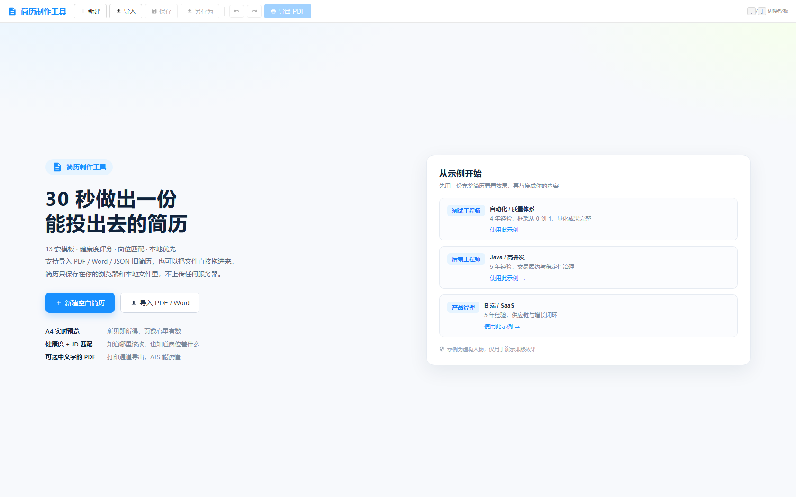
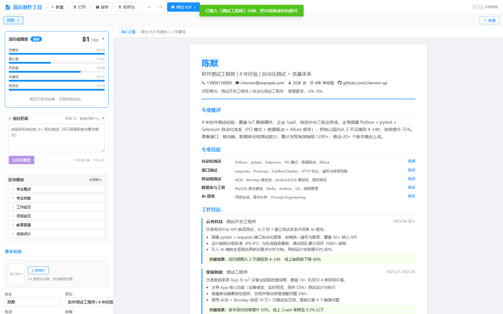
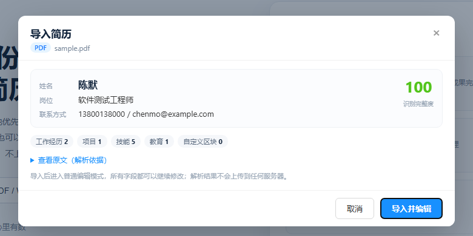

# resume-tool · 简历制作工具

> 一个本地优先的 Vue 3 简历工作台：旧简历导入（PDF / Word / JSON）、欢迎页示例、13 套模板缩略图、A4 分页预览、可选中文字的 PDF、Word 导出、撤销重做、岗位 JD 匹配。所有数据只留在浏览器和本地文件里。







## 在线演示

仓库自带 GitHub Pages 部署流程（`.github/workflows/deploy.yml`）。推送到 `main` 后，在仓库 Settings → Pages 中选择 **GitHub Actions**，即可获得在线地址：

```
https://<你的用户名>.github.io/resume-tool/
```

也可以本地直接使用：下载 Release 构建产物，解压后双击 `index.html`（基于 `base: './'` 的 `file://` 部署）。

## 功能特性

| # | 功能 | 说明 |
|---|------|------|
| 1 | 旧简历导入 | PDF / Word（.docx）/ JSON / TXT，本地抽取文本 + 规则解析，导入前弹窗确认识别结果；支持把文件直接拖进页面 |
| 2 | 欢迎页 + 三套示例 | 测试 / 后端 / 产品三个方向，点一下就能看到填满后的效果，30 秒完成 0→1 |
| 3 | 13 套模板 + 缩略图 | 8 套单列可变序 + 5 套固定布局，模板卡片直接显示真实排版缩略图 |
| 4 | A4 分页预览 | 210mm 页宽 + 297mm 分页线 + 实时页数，超过 2 页会提示精简 |
| 5 | 可选中文字的 PDF | 浏览器打印通道输出矢量文字，ATS 可解析；html2pdf 作为兼容模式保留 |
| 6 | Word（.docx）导出 | 单栏、可编辑，适配国内投递系统 |
| 7 | 岗位 JD 匹配 | 粘贴 JD，本地抽取关键词并计算覆盖率，列出「JD 提到但简历没写」的技能；可选 AI 深度分析（语义缺口 + 定位到区块的修改建议，本地匹配分保持免费） |
| 8 | 简历健康度 | 5 维 100 分 + 可点击定位的改进建议 |
| 9 | 撤销 / 重做 | 每个 Tab 独立快照栈（最多 40 步），Ctrl+Z / Ctrl+Shift+Z |
| 10 | 多 Tab 会话 | 类 IDE 多 Tab，标题跟随姓名，重复打开同一文件会自动切换 |
| 11 | 三级拖拽排序 | 区块级 + 列表项级 + 工作内容子项级 |
| 12 | 证件照 | 上传后自动按 3:4 居中裁剪压缩，Executive / QA专业 / 科技渐变 三套模板已支持 |
| 13 | 自动保存 + 崩溃恢复 | localStorage 兜底，刷新/崩溃后启动时恢复「孤儿 Tab」 |
| 14 | AI 能力（可选，自带 Key） | 工具栏齿轮配置 DeepSeek / OpenAI 兼容 / OpenRouter / OpenAI / Ollama 后解锁：旧简历 AI 解析、JD 深度分析、单条经历润色（强化动词 / 突出成果 / 精简 / 自定义）、**AI 聊天助手**（提案式修改简历，逐条采纳/忽略，Ctrl+Z 可撤销）、**简历优化工程师**（差距分析 → 访谈真实经历 → 定制提案，AI 只整理你说过的素材、绝不编造） |
| 15 | 投递记录台账 | 工具栏公文包：粘贴 Boss直聘等平台的 JD 存为岗位记录，状态流转（意向→投递→沟通→约面→面试→offer）+ 漏斗统计 + 备注时间线；一键「分析 JD」复用岗位匹配与 AI 深度分析，「派生简历版本」生成岗位定制副本；JSON 导入导出，纯本地不连接任何平台 |
| 16 | Boss直聘直连（可选，默认关闭） | 本地伴随进程（`mcp-server/`）：粘贴岗位链接一键抓取 JD 进台账，并把只读工具以 MCP 协议暴露给 Claude 等外部 Agent；**只读 + 限速 + 遇风控即停**，登录态与全部数据收敛在项目 `.mcp/` 目录（详见 [mcp-server/README.md](./mcp-server/README.md) 的风险声明） |
| 17 | 本地优先 | **未配置 AI 时业务代码零网络请求**；导入解析、JD 关键词匹配、健康度与投递台账全部本地计算；AI 仅在点击对应按钮时把你可见的文本发给你自己配置的服务商，Key 只存本地浏览器 |
| 18 | 文件读写降级 | Chromium 走 File System Access API；Firefox / Safari 自动降级为下载 JSON |
| 19 | 键盘快捷键 | Ctrl+S / Ctrl+O / Ctrl+P / Ctrl+Shift+N / Ctrl+Shift+S / Ctrl+Z / Ctrl+Shift+Z / `[` `]` |

## 技术栈

| 类别 | 技术 |
|------|------|
| 框架 | Vue 3（Composition API + `<script setup>`） |
| 语言 | TypeScript（strict 模式） |
| 构建 | Vite 5 |
| 状态 | Pinia |
| 拖拽 | vuedraggable |
| 导入 | pdfjs-dist（PDF 文本层）、mammoth（Word） |
| 导出 | 浏览器打印（文本 PDF）、html2pdf.js（图片 PDF）、docx（Word） |
| AI（可选） | 浏览器直连 OpenAI 兼容协议（fetch 实现，无 SDK 依赖），zod 校验模型输出 |
| 测试 | Vitest + @vue/test-utils + jsdom、Playwright |
| 质量 | vue-tsc、ESLint、GitHub Actions |

## 快速开始

### 环境要求

- **Node.js** ≥ 18
- **npm** ≥ 9（或 pnpm / yarn）
- 现代浏览器（推荐 Chrome / Edge 86+）

### 安装与运行

```bash
git clone <repo-url>
cd resume-tool
npm install

npm run dev       # 开发服务器 http://localhost:5173
npm run build     # 类型检查 + 生产构建
npm run preview   # 预览构建产物
```

### 常用脚本

| 命令 | 作用 |
|------|------|
| `npm run dev` | 启动开发服务器 |
| `npm run build` | `vue-tsc --noEmit` + `vite build` |
| `npm test` | 单元测试（Vitest） |
| `npm run test:coverage` | 覆盖率报告 |
| `npm run e2e` | Playwright E2E |
| `npm run lint` | ESLint |
| `npm run thumbs` | 重新生成模板缩略图（改了模板样式后执行） |

## 使用说明

### 导入旧简历

工具栏「导入」或欢迎页「导入 PDF / Word」支持：

| 格式 | 说明 |
|------|------|
| PDF | 读取文本层，扫描件/图片型 PDF 会明确提示不支持 |
| Word（.docx） | mammoth 抽取段落，复杂表格会退化为文本 |
| JSON | 本工具导出的文件，直接还原模板与主题 |
| TXT / MD | 粘贴或导出成纯文本的简历，走同一套规则解析 |

导入后会先弹出确认页，展示姓名、岗位、联系方式、各区块数量、识别完整度与警告，并附原文预览。确认后进入普通编辑模式，所有字段都可以继续修改。

> 解析是本地规则（不用 AI）：能识别常见中文简历的标题、日期区间、公司/职位、项目与教育，但不保证 100% 准确；识别不到的字段会留空并给出提示。

### 从示例开始

首次打开会进入欢迎页：可以新建空白简历、导入旧简历，或直接选择一套示例（测试 / 后端 / 产品）。示例是虚构人物，替换内容即可。

### 选择模板

编辑面板中的模板卡片带有真实缩略图，按「经典稳重 / 现代简约 / 专业测试 / 创意活力」分组；`[` / `]` 可快速切换。8 套单列模板支持调整区块顺序，5 套固定布局使用预设版式。

### 导出

工具栏「导出 PDF」提供三条通道：

1. **打印 / 另存为 PDF（推荐）**：在打印窗口选择「另存为 PDF」，得到可选中、可复制、ATS 可解析的文本 PDF；
2. **Word 文档（.docx）**：单栏可编辑版本，适合国内投递系统；
3. **图片 PDF（兼容模式）**：html2pdf 光栅化，复杂样式还原度最高，但文字不可选中。

### 岗位匹配

在「岗位匹配」卡片粘贴 JD → 点击「分析匹配度」，会得到关键词覆盖率、已覆盖项和缺失项。分析完全在浏览器本地完成，不会上传 JD 或简历。

### 快捷键

| 快捷键 | 功能 |
|--------|------|
| `Ctrl + S` | 保存当前简历 |
| `Ctrl + Shift + S` | 另存为 |
| `Ctrl + O` | 导入 PDF / Word / JSON |
| `Ctrl + P` | 打印 / 另存为 PDF |
| `Ctrl + Shift + N` | 新建简历 Tab |
| `Ctrl + Z` / `Ctrl + Shift + Z` | 撤销 / 重做（输入框内保留浏览器原生撤销） |
| `[` / `]` | 上一个 / 下一个模板 |

## 项目结构

```
src/
├── components/
│   ├── sections/          # 编辑区块（含模板选择、岗位匹配、照片上传）
│   ├── templates/         # 13 个模板 + 6 个共享子组件
│   ├── WelcomePanel.vue   # 欢迎页
│   ├── ImportDialog.vue   # 导入确认弹窗
│   ├── EditorPanel.vue    # 编辑面板（健康度 + 区块顺序）
│   ├── PreviewPanel.vue   # A4 分页预览
│   ├── Toolbar.vue        # 工具栏与导出菜单
│   ├── TabBar.vue         # 多 Tab
│   └── ...
├── composables/           # autoSave / undoHistory / printExport / pdfExport / docxExport / sectionOrder / shortcuts / startupRecovery
├── stores/                # tabs / fileSystem / ui
├── data/                  # 示例简历、模板缩略图映射
├── utils/                 # importFile / importText / extractPdf / extractDocx / parseResume / jdMatch / healthScore / page / image / docxExport / theme / errors
├── assets/template-thumbs # 13 张模板缩略图（npm run thumbs 生成）
└── styles/                # main.css + print.css
e2e/                       # Playwright：smoke / drag-sort / multi-tab / features / import
scripts/                   # 开发脚本（模板缩略图生成）
```

## 测试

```bash
npm test            # 单元测试
npm run test:coverage
npm run e2e         # 首次需 npx playwright install
```

当前基线：**41 个单元测试文件 / 360 个用例**，**20 条 E2E**，覆盖导入解析（PDF / Word / 文本）、健康度、JD 匹配、撤销栈、A4 分页、模板渲染、导出流程。

## 浏览器兼容性

| 浏览器 | 支持情况 |
|--------|----------|
| Chrome / Edge ≥ 86 | ✅ 完整支持（原生文件读写、PDF/Word 导入、打印 PDF、Word 导出） |
| Firefox / Safari 现代版本 | ✅ 编辑 / 预览 / 打印 PDF / Word / 导入 / 撤销可用；保存自动降级为下载 JSON |
| 所有现代浏览器 | ✅ 编辑、预览、拖拽、localStorage 兜底可用 |

> 打印 PDF 依赖浏览器打印对话框；不同浏览器的分页结果可能略有差异，建议用 Chrome / Edge 导出最终版。
> PDF / Word 导入在浏览器本地完成：PDF 使用 pdf.js worker，首次导入会加载约 1.4MB 的 worker 文件（之后走缓存）。
> 通过 `file://` 双击打开时，部分浏览器会限制 Web Worker，PDF 导入可能不可用；建议用 `npm run dev`、`npm run preview` 或在线版本导入 PDF / Word。

## 数据与隐私

- 简历内容只写入你选择的本地文件和浏览器 localStorage，不上传服务器；
- PDF / Word 导入在浏览器本地解析，文件不会离开设备；
- 岗位匹配使用内置技能词典在本地计算，不调用任何 AI 接口；
- 仓库通过 `.gitignore` 排除了 `my-resume/`、`resume-docs/`，避免个人简历被误提交。

## 许可证

[MIT License](./LICENSE)

## 贡献指南

欢迎提交 Issue 与 PR。开发环境、代码规范、测试要求与 PR 流程见 [CONTRIBUTING.md](./CONTRIBUTING.md)。
